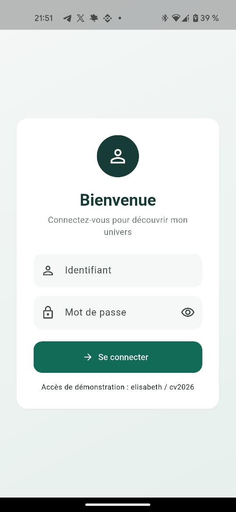
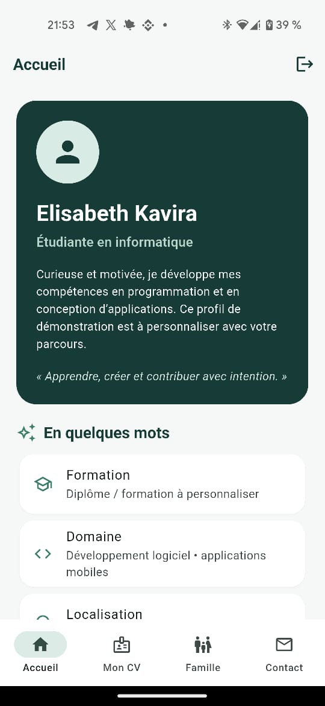
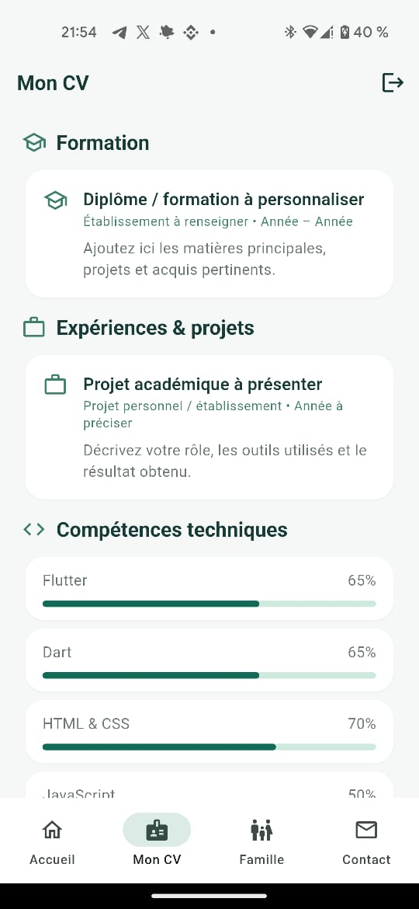
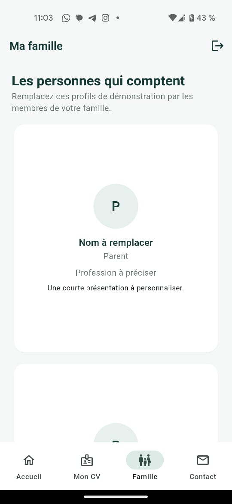
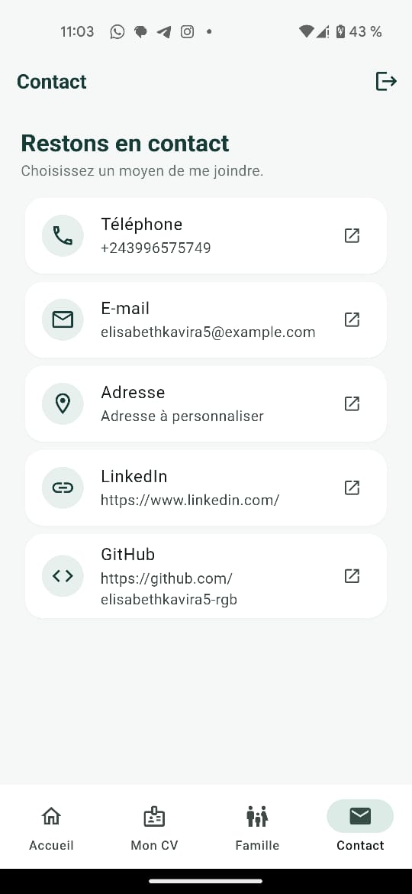

# CV Flutter Elisabeth — TP2

Application Flutter de présentation d’un CV personnel, enrichie d’une authentification et d’une gestion des membres de famille via l’API REST PHP/MySQL fournie pour le cours.

Les pages Accueil, Mon CV et Contact gardent le contenu, le thème vert, les transitions et la navigation du TP1. La page Famille lit et modifie les données du serveur. Les captures TP1 sont conservées dans `screenshots/`.

## Fonctionnalités

- Création d’un compte et connexion par e-mail auprès de l’API.
- Consultation, ajout, modification, suppression et actualisation des membres de famille.
- Affichage des portraits lorsque l’API renvoie `image_url`.
- Parcours CV, accueil, contact et déconnexion conservés.
- États de chargement, erreurs API et confirmation avant suppression.

## Captures d’écran

Les captures du TP1 sont conservées dans `screenshots/` :

### Connexion



### Accueil



### Mon CV



### Famille



### Contact



## Technologies et architecture

- Flutter / Dart, Material 3.
- Packages : `http`, `file_picker`, `url_launcher`, `cupertino_icons`.
- `lib/main.dart` : écrans, navigation et formulaires.
- `lib/services/api_service.dart` : appels HTTP et erreurs serveur.
- `lib/models/family_member.dart` : modèle et conversion JSON.
- `lib/data/` : contenu CV local conservé ; `lib/theme/` : thème TP1.

## Prérequis et API

Le dépôt API distinct du projet Flutter est [espoirbaraka/api-test](https://github.com/espoirbaraka/api-test). Il s’agit d’une API PHP sans framework. Son URL de base est `http://localhost/api-test/public` : le segment `/public` est nécessaire. Le README du backend indique qu’aucun endpoint n’est protégé par authentification. La connexion vérifie donc bien un compte côté serveur, mais ne protège pas les routes Famille.

Installation locale sous Windows/XAMPP :

1. Cloner le dépôt API dans `C:\xampp\htdocs\api-test`.
2. Démarrer **Apache** et **MySQL** dans XAMPP Control Panel.
3. Dans phpMyAdmin, créer une base vide nommée `api`, puis importer `C:\xampp\htdocs\api-test\api.sql` une seule fois. Le script crée `account`, `famille_membre` et `tbl_etudiant`. Ne le réimportez pas dans une base qui contient déjà des données à conserver.
4. Copier `.env.example` en `.env` dans le dossier API. Configurer `DB_HOST`, `DB_PORT`, `DB_DATABASE`, `DB_USERNAME` et `DB_PASSWORD` selon les paramètres réellement configurés dans MySQL local.
5. Ouvrir `http://localhost/api-test/public/famille-membres` pour vérifier l’API après démarrage.

Le dépôt API décrit des réponses JSON de la forme `{ "success": true, "message": "…", "data": … }` et les erreurs avec `message` et, éventuellement, `errors`. Ses dépendances PHP sont natives (PDO et extensions PHP nécessaires à PDO MySQL) ; le README ne demande pas Composer.

### Routes utilisées

| Méthode | Route | Utilité |
|---|---|---|
| `POST` | `/accounts/login` | Connexion (`email`, `password`) |
| `POST` | `/accounts/register` | Inscription (`email`, `password`) |
| `GET` | `/famille-membres` | Liste serveur |
| `POST` | `/famille-membres` | Création JSON |
| `PUT` | `/famille-membres/{id}` | Mise à jour JSON |
| `DELETE` | `/famille-membres/{id}` | Suppression |

Les champs famille sont `nom`, `postnom`, `prenom`, `lieu_naissance`, `date_naissance` (`AAAA-MM-JJ`) et `parente`. L’image est facultative : l’application accepte JPG, PNG, GIF ou WebP jusqu’à 2 Mo, l’envoie en multipart/form-data et affiche `image_url` quand le serveur en renvoie une. Une mise à jour sans nouvelle image conserve l’image déjà enregistrée.

## Lancer l’application

Depuis la racine du projet :

```bash
flutter pub get
flutter run
```

Par défaut, l’URL API est `http://localhost/api-test/public` (pratique pour Flutter Web ou Windows). Pour un émulateur Android, `localhost` désigne l’émulateur ; utiliser l’adresse spéciale de l’hôte Android :

```bash
flutter run --dart-define=API_BASE_URL=http://10.0.2.2/api-test/public
```

Sur un téléphone réel, remplacer `10.0.2.2` par l’adresse IP locale de l’ordinateur et autoriser Apache dans le pare-feu. Android autorise ici HTTP en clair pour le serveur XAMPP local ; utiliser HTTPS pour un déploiement public.

## Vérifications

```bash
flutter analyze
flutter test
```

L’API doit être démarrée avant la connexion et l’accès à Famille. Aucun identifiant de compte n’est livré : créer un compte depuis l’écran de connexion, puis s’y connecter. Aucune requête API ni opération CRUD n’a pu être exercée dans l’environnement de préparation si XAMPP/API ne sont pas actifs.

## Démonstration vidéo

[Regarder la démonstration de l’application](https://github.com/user-attachments/assets/7009a93f-bac1-4e2f-bcd2-a595329f72f6)

## Publication Git

Le dépôt Flutter existant est `origin` (distinct du dépôt API). Après revue des changements, les commandes de publication sont :

```bash
git add README.md pubspec.yaml pubspec.lock lib android/app/src/main/AndroidManifest.xml test/widget_test.dart
git commit -m "Connect CV app to family REST API"
git push origin main
```

La publication n’est pas effectuée automatiquement.
